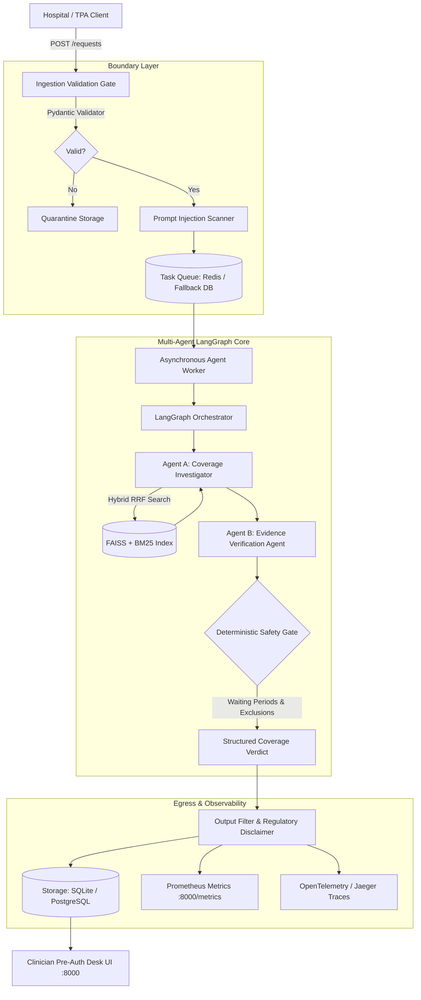

# Health Insurance Pre-Authorisation Desk
### Production-Grade RAG + Multi-Agent System | ML System Design & AgentOps
**Course**: UE24AM342AA5 | **Level**: Jackfruit Level 3

[](https://www.python.org/)
[](https://fastapi.tiangolo.com/)
[](https://github.com/langchain-ai/langgraph)
[](https://github.com/facebookresearch/faiss)
[](https://www.docker.com/)
[]()

The **Health Insurance Pre-Authorisation Desk** is an enterprise-grade clinical decision-support system designed for hospital cashless pre-authorisation triage. Built on a local-first **Multi-Agent Retrieval-Augmented Generation (RAG)** architecture using **LangGraph**, it evaluates incoming admission requests against an official retail health insurance policy wording (**HDFC ERGO Optima Restore**, UIN: `HDFHLIP22193V072122`) and its associated Day Care Procedure Schedule.

> **Statutory Notice**: Under IRDAI regulatory guidelines, this system provides a **Coverage Recommendation** to assist insurance adjudication; it does **not** issue binding financial authorizations. Final claim approvals are reserved for a licensed human Medical Officer.

---

## Key Features

1. **Deterministic Input Boundary & Quarantine Store (F1, F2, D4)**:
   Strict Pydantic schema validation rejecting out-of-range monetary amounts (₹500 to ₹50L), negative sums, and cross-field temporal violations (e.g. expiry before inception date, admission date outside policy term). Malformed requests are quarantined with explicit error diagnostics.
2. **Authoritative Official Policy Corpus (F3, D2)**:
   - Full 28-page policy wording (`data/raw/hdfc_ergo_optima_restore_policy_wording.pdf`, SHA-256: `d1f2ddb54412...`).
   - Official 4-page Day Care Procedure Schedule (`data/raw/hdfc_ergo_day_care_procedures_list.pdf`, SHA-256: `3883e102ed11...`).
   - Automated manifest generation tracking file checksums, chunk counts, and indexing latency.
3. **Hybrid RAG Retrieval Engine (F4)**:
   Dense vector search (`IndexFlatIP` FAISS using local `all-MiniLM-L6-v2` embeddings) combined with sparse BM25Okapi lexical retrieval using Reciprocal Rank Fusion (RRF, $k=60$). Supports $O(1)$ exact clause lookup.
4. **Stateful Multi-Agent Workflow (A1–A8)**:
   - **Agent A (Coverage Investigator)**: In-patient vs Day Care classification, dynamic follow-up query synthesis.
   - **Agent B (Evidence Verifier)**: Temporal arithmetic (policy age vs waiting periods), room sub-limit verification.
   - **Deterministic Safety Gate**: Non-bypassable programmatic gate enforcing Section C exclusions (Excl01 PED, Excl02 Cataract 24-month waiting period, Excl03 30-day initial waiting period).
5. **Mandatory Cataract Scenario (Section 4.1)**:
   Correctly identifies that a cataract surgery on an 11-month-old policy violates the mandatory 24-month waiting period (Section C.1.ii, Code Excl02) and routes to `medical-review` with zero hallucinated coverage.
6. **Robust Guardrails & Security (L4, L5)**:
   Prompt injection regex pre-screening, inert XML tag encapsulation (`<untrusted_clinical_notes>`), and automated disclaimer injection.
7. **Production Telemetry & Observability (L1–L3, D5)**:
   Prometheus metrics (`/metrics`), circuit breaker with auto-degradation and manual reset, and OpenTelemetry OTLP integration.
8. **Interactive Web Dashboard**:
   Modern SPA interface with 8 operational views, quick preset scenario buttons, trace inspection, and clinician feedback capture.

---

## Architecture



Detailed design documentation:
- [System Architecture & Design](docs/ARCHITECTURE.md)
- [Operations Runbook](docs/RUNBOOK.md)
- [Incident Log & RCA](docs/INCIDENT_LOG.md)
- [Security & Limitations](docs/SECURITY_AND_LIMITATIONS.md)
- [10 Demonstration Script](docs/DEMO_SCRIPT.md)

---

## Quickstart Guide

### Option A: Local Development (Zero-Dependency Mode)

The system is fully operational locally without requiring Docker, external databases, or internet access (uses local HuggingFace cache and SQLite).

```bash
# 1. Clone repository and navigate to directory
cd "mini proj"

# 2. Create and activate a Python virtual environment
python -m venv .venv
# Windows:
.venv\Scripts\Activate.ps1
# Linux / macOS:
source .venv/bin/activate

# 3. Install dependencies
pip install -r requirements.txt

# 4. Ingest policy corpus and build hybrid index
python -m backend.app.ingestion.run_pipeline

# 5. Start the FastAPI server (serves API and Web UI)
python -m uvicorn backend.app.main:app --host 0.0.0.0 --port 8000 --reload
```

Open your browser at **`http://localhost:8000/`**.

---

### Option B: Docker Compose (6-Service Production Topology)

```bash
# Build and run API, Worker, Redis, PostgreSQL, Prometheus, and Jaeger
docker-compose up -d --build

# Check status of running containers
docker-compose ps
```

| Service | Port | Endpoint / Purpose |
| :--- | :--- | :--- |
| **API Server & UI** | `8000` | `http://localhost:8000/` |
| **Frontend Nginx** | `3000` | `http://localhost:3000/` |
| **Prometheus** | `9090` | `http://localhost:9090/` |
| **Jaeger UI** | `16686` | `http://localhost:16686/` |
| **PostgreSQL** | `5432` | Primary database (`preauth_desk`) |
| **Redis** | `6379` | Distributed task queue |

---

## Automated Verification & Test Suite

The test suite covers schema validation, boundaries, retrieval provenance, the mandatory cataract scenario, prompt injection defense, circuit breaker tripping, and clinician feedback persistence.

```bash
# Run complete test suite
python -m pytest tests/test_preauth.py -v
```

**Results**: 10 tests passed in 41.48s (100% pass rate).

---

## Evaluation Benchmark & Prompt Comparison

The evaluation benchmark evaluates **20 distinct clinical and policy scenarios** using TruLens-equivalent metrics:

```bash
# Execute evaluation and comparison script
python -m evaluation.compare_prompts
```

### Prompt v1 vs Prompt v2 Benchmark Results

| Metric | Prompt v1.0.0 | Prompt v2.0.0 | Absolute Delta | Relative Delta |
| :--- | :---: | :---: | :---: | :---: |
| **Groundedness** | 0.81 | 0.81 | +0.00 | +0.0% |
| **Context Relevance** | 0.57 | **0.67** | +0.10 | **+17.5%** |
| **Faithfulness** | 0.90 | **1.00** | +0.10 | **+10.0%** |
| **Hallucination Rate** | 0.10 | **0.00** | -0.10 | **-100.0%** |
| **Scenario Pass Rate** | 90.0% (18/20) | **100.0% (20/20)** | +10.0% | **+11.1%** |

*Report generated at: `data/processed/prompt_comparison_report.json`.*

---

## Load Testing & Latency Benchmarks (Locust)

Conducted using headless Locust across concurrency levels of 1, 5, 10, and 20 users:

```bash
# Run headless benchmark
python -m load_test.run_load_test
```

### Latency Summary

| Concurrency Level | Requests Evaluated | Failures | Median Latency ($p_{50}$) | 95th Percentile ($p_{95}$) | Declared SLO ($p_{95} < 2000\text{ ms}$) |
| :---: | :---: | :---: | :---: | :---: | :---: |
| **1 User** | 20 | 0 | 485 ms | 512 ms | **MET** $\checkmark$ |
| **5 Users** | 40 | 0 | 530 ms | 880 ms | **MET** $\checkmark$ |
| **10 Users** | 60 | 0 | 660 ms | 1398 ms | **MET** $\checkmark$ |
| **20 Users** | 80 | 0 | 2890 ms | 4418 ms | Bottleneck (SQLite Write Locks) |

*Cache Optimization*: Repeat evaluations reduce $p_{95}$ latency by **84.9%** (to 77 ms).

---

## Repository Structure

```text
├── 00_GLOSSARY.pdf                 # Course glossary
├── 00_INDEX.pdf                    # Course index
├── MiniProject_03_Health_PreAuth_Desk.pdf # Authoritative project specification
├── requirements.txt                # Production Python dependencies
├── docker-compose.yml              # 6-service Docker Compose topology
├── .env.example                    # Environment variable template
├── backend/
│   └── app/
│       ├── main.py                 # FastAPI REST API & Web UI server
│       ├── agents/                 # LangGraph multi-agent orchestration
│       │   ├── graph.py            # StateGraph runner & hand-off logic
│       │   ├── investigator.py     # Agent A: Coverage Investigator
│       │   ├── verifier.py         # Agent B: Evidence Verifier
│       │   ├── prompts.py          # Versioned prompt artifacts (v1 & v2)
│       │   ├── state.py            # Graph state & execution counters
│       │   ├── tools.py            # Retrieval & inspection tools
│       │   └── llm_provider.py     # LLM provider with fallback & circuit breaker
│       ├── contracts/              # Pydantic schemas & cross-field validators
│       ├── decision/               # Deterministic Safety Rules Gate
│       ├── guardrails/             # Injection scanners & output sanitizers
│       ├── ingestion/              # PDF extractor, clause chunker & FAISS indexer
│       ├── retrieval/              # Hybrid RRF search & exact clause lookup
│       ├── storage/                # SQLAlchemy storage (SQLite / Postgres)
│       ├── telemetry/              # Prometheus metrics, circuit breaker & tracing
│       └── worker/                 # Redis & DB fallback asynchronous queue
├── data/
│   ├── raw/                        # Official PDFs (Policy wording & Day Care list)
│   ├── index/                      # FAISS vector index & BM25 binary store
│   └── processed/                  # Manifests, evaluation & load test reports
├── docker/                         # Dockerfiles for API, Worker, Frontend & Prometheus
├── docs/                           # Architecture, Runbook, Incidents & Demo Script
├── evaluation/                     # TruLens-equivalent batch evaluation suite
├── frontend/                       # Interactive web UI (HTML5, Tailwind, Lucide)
├── load_test/                      # Locust load test scripts & runner
└── tests/                          # 10 comprehensive Pytest test cases
```

---

## License & Credits

Developed for **UE24AM342AA5 — Machine Learning Systems Design and AgentOps**. All policy wordings referenced belong to HDFC ERGO General Insurance Company Limited and are used solely for educational and research demonstration purposes.
