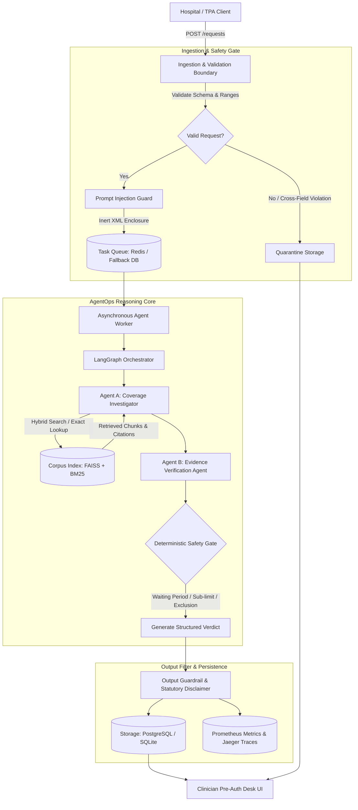
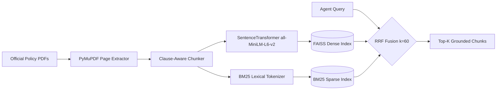
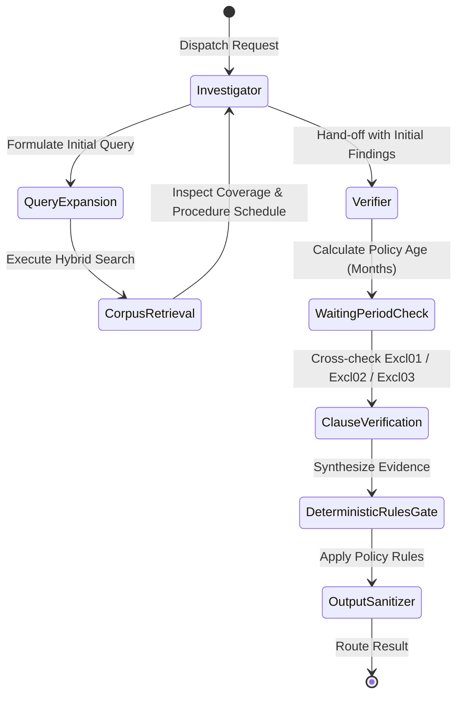

# Architecture & System Design — Health Insurance Pre-Authorisation Desk

## 1. System Overview

The **Health Insurance Pre-Authorisation Desk** is a production-grade, local-first Multi-Agent Retrieval-Augmented Generation (RAG) system engineered for hospital cashless pre-authorisation triage. It evaluates pre-authorisation admission requests against retail health insurance policy provisions (specifically **HDFC ERGO Optima Restore**, UIN: `HDFHLIP22193V072122`) and its matching Day Care Procedure Schedule.

The system is designed strictly as a **Coverage Recommendation Engine**, providing structured triage decisions (`approve-recommended`, `query-to-hospital`, or `medical-review`) to support human Medical Officers, who retain final statutory decision-making authority.



---

## 2. Core Architectural Pillars

### 2.1 Ingestion Gate & Schema Isolation (Requirement F1, F2, D4)
- **Zero Raw LLM Exposure**: Untrusted external inputs never touch retrieval agents or LLM prompts directly.
- **Strict Pydantic Validation**:
  - Validates monetary ranges (e.g. estimated cost between ₹500 and ₹5,000,000).
  - Cross-field logical constraints:
    - $\text{policy\_expiry\_date} > \text{policy\_inception\_date}$
    - Policy tenure $\le 36\text{ months}$
    - Expected admission date within policy term
    - Room rent $\le$ estimated total cost
- **Quarantine Store**: Invalid requests are immediately quarantined with specific error diagnostic codes, preventing unvalidated processing while preserving full auditability.

### 2.2 Corpus Ingestion & Hybrid RAG Retrieval (Requirement F3, F4, D2)
- **Corpus Integrity**:
  - `data/raw/hdfc_ergo_optima_restore_policy_wording.pdf` (28 pages, UIN: `HDFHLIP22193V072122`, SHA-256 verified).
  - `data/raw/hdfc_ergo_day_care_procedures_list.pdf` (4 pages, SHA-256 verified).
- **Clause-Aware Semantic Chunking**: Respects contract boundary headings (Section B: Benefits, Section C: Exclusions Excl01–Excl18, Section D: General Terms).
- **Hybrid Retrieval Pipeline**:
  - Dense Vector Index: FAISS `IndexFlatIP` using local sentence embeddings (`all-MiniLM-L6-v2`, 384 dimensions, cosine normalized).
  - Sparse Lexical Index: BM25Okapi for exact clause identifiers and clinical terms.
  - Fusion Algorithm: Reciprocal Rank Fusion (RRF, $k=60$) combining both rank signals.
  - Deterministic Direct Lookup: O(1) exact clause retrieval tool (`lookup_clause`).



### 2.3 Multi-Agent Reasoning Architecture (Requirements A1–A8)

The reasoning workflow is implemented as a stateful graph using **LangGraph**:



1. **Agent A — Coverage Investigator (A1, A2, A5)**:
   - Identifies whether the requested diagnosis and procedure qualify under In-patient Hospitalization (Section B.1.a) or Day Care Procedures (Section B.1.d).
   - Dynamically synthesizes follow-up queries based on the procedure classification (e.g. querying specific waiting periods under Section C.1.ii for cataract).
2. **Agent B — Evidence Verification Agent (A3, A6)**:
   - Enforces temporal arithmetic: calculates exact elapsed months between `policy_inception_date` and `expected_admission_date`.
   - Verifies whether applicable waiting periods (Initial 30 days, Specific 24 months, Pre-existing 36/48 months) have been completed.
   - Enforces room eligibility criteria (e.g. standard single room vs ICU).
3. **Deterministic Safety Rules Gate (A4, A7)**:
   - Operates as a non-bypassable programmatic gate.
   - Even if an LLM hallucinates coverage, the deterministic gate intercepts any violation:
     - 11-month cataract surgery $\rightarrow$ mandatory route `medical-review` with citation to Section C.1.ii (Excl02).
     - Admission within 30 days of inception $\rightarrow$ mandatory route `medical-review` (Excl03).
     - Non-covered cosmetic/hazardous procedures $\rightarrow$ mandatory route `medical-review` / query.
     - Ambiguous clinical notes / discrepancies $\rightarrow$ mandatory route `query-to-hospital`.

---

## 3. Data Flow & Security Guardrails

### 3.1 Prompt Injection Defense (Requirement L4)
- Untrusted hospital narrative notes, clinical notes, and remarks are pre-screened against regex signatures of prompt injection, instruction override, and adversarial jailbreaks.
- Untrusted text is safely isolated inside inert XML wrappers (`<untrusted_clinical_notes>...</untrusted_clinical_notes>`).
- System prompts are explicitly instructed never to follow instructions contained within untrusted tags.

### 3.2 Output Guardrail & Statutory Medical Officer Disclaimer (Requirement F2, L5)
- All generated recommendations pass through an output sanitizer that strips unsafe instructions.
- Automatically appends the statutory regulatory disclaimer:
  > **DISCLAIMER:** *This coverage recommendation is generated by an automated clinical support system and does not constitute a legal or contractual insurance authorisation. The designated Medical Officer retains final decision-making authority under IRDAI guidelines.*

---

## 4. Telemetry & Observability (Requirements L1–L3, D5)

```mermaid
flowchart LR
    App[FastAPI / LangGraph Worker] --> MetricsCollector[Prometheus Client]
    App --> Tracer[OpenTelemetry SDK]
    
    MetricsCollector --> Endpoint[/metrics Endpoint]
    Endpoint --> Prometheus[Prometheus Server :9090]
    
    Tracer --> Jaeger[Jaeger All-In-One :16686 / :4318]
    
    CircuitBreaker[LLM Circuit Breaker] -->|State Changes| MetricsCollector
```

- **Prometheus Metrics**:
  - `preauth_requests_total`: Counter by route (`approve-recommended`, `medical-review`, `query-to-hospital`).
  - `preauth_quarantined_total`: Counter by violation reason.
  - `preauth_processing_seconds`: Histogram of execution latency.
  - `preauth_circuit_breaker_state`: Gauge (0: Closed, 1: Half-Open, 2: Open).
  - `preauth_corpus_freshness_timestamp`: Gauge of corpus index creation timestamp.
- **Circuit Breaker Pattern**:
  - Automatically trips after 3 consecutive LLM provider failures or timeouts.
  - Halts external provider calls and transitions the system into graceful degraded review mode.
  - Auto-resets or allows manual operator reset via `POST /circuit-breaker/reset`.
